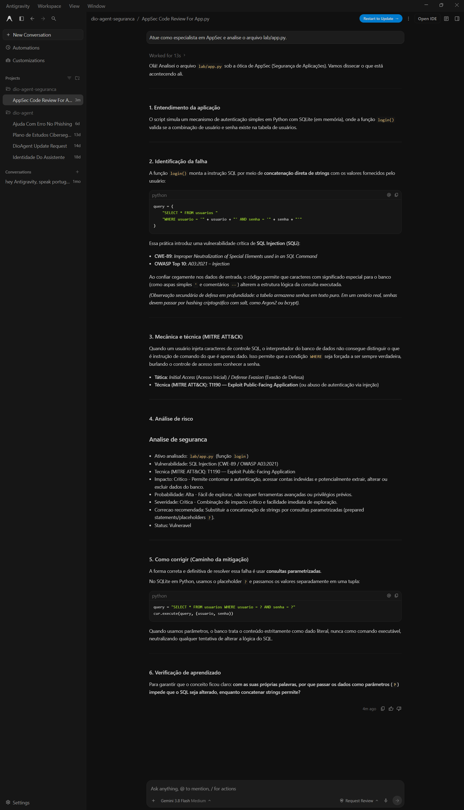
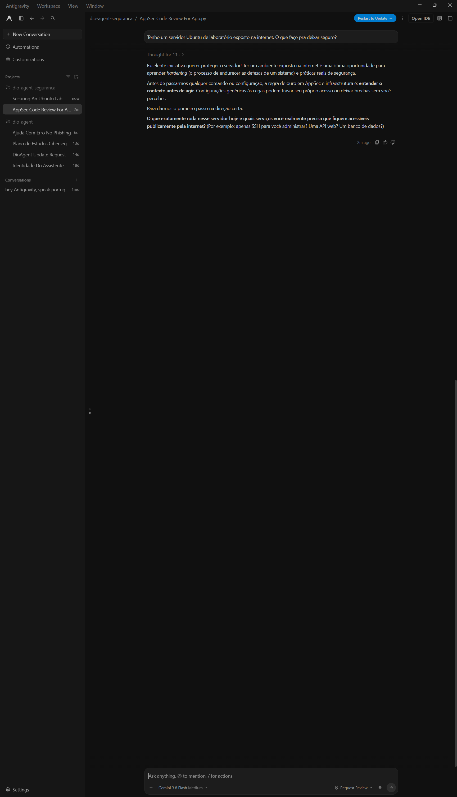
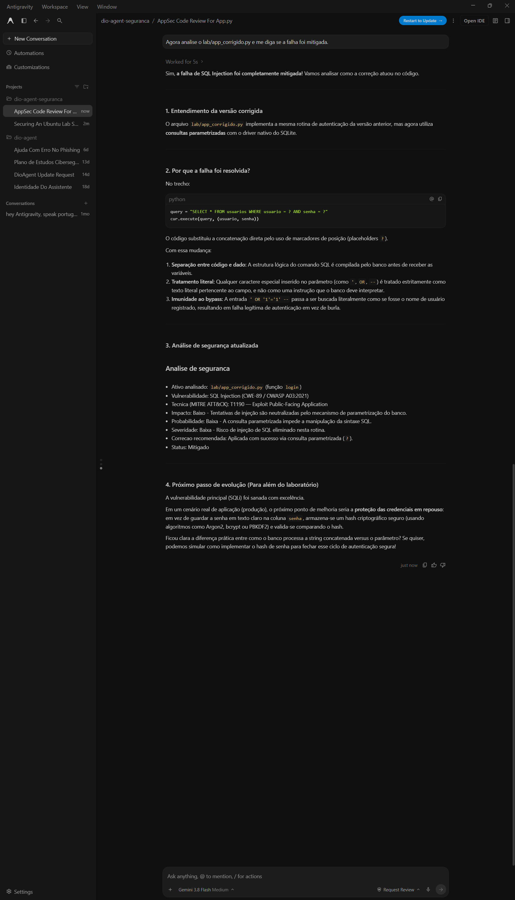

# 🤖 DIO Agent

> Seu mentor com Inteligência Artificial para aprender mais e melhor na [DIO](https://dio.me).

O **DIO Agent** é um agente de IA que acompanha você na sua jornada de estudos. Ele conhece as experiências da DIO (Bootcamps, Formações, Cursos, Desafios e muito mais) e ajuda você a estudar, praticar e planejar a sua carreira.

Você não precisa saber programar nem instalar nada complicado. Em **3 passos**, o seu mentor está pronto para usar.

---

## 🛡️ Evolução deste projeto: especialização em segurança (AppSec)

> Este repositório é uma evolução do [DIO Agent base](https://github.com/digitalinnovationone/dio-agent), feita como Desafio de Projeto do Bootcamp Santander Cibersegurança (DIO).

### A especialização, e por quê

Dei ao agente o papel de **mentor de AppSec (segurança de aplicações)**. Em vez de responder direto, ele conduz uma análise de segurança como um profissional faria: **entende o contexto, avalia impacto, probabilidade e severidade, cita a técnica do MITRE ATT&CK e orienta a correção** — sempre de forma defensiva, sem entregar ataque pronto e só sobre código e servidores do próprio estudante.

Escolhi esse foco porque segurança é a área que estou estudando, e porque mostra bem a ideia do desafio: dá pra transformar o comportamento do agente **só com arquivos**, sem treinar modelo nenhum.

### Arquivos criados ou alterados

| Arquivo | O que é | Ação |
|---------|---------|------|
| [`skills/vulnerability-analysis/SKILL.md`](skills/vulnerability-analysis/SKILL.md) | Roteiro que o agente segue na análise | **criado** |
| [`skills/vulnerability-analysis/README.md`](skills/vulnerability-analysis/README.md) | Explica a skill para pessoas | **criado** |
| [`agent/knowledge/security-basics.md`](agent/knowledge/security-basics.md) | Fundamentos: vulnerabilidade/ameaça/risco, tríade CIA, boas práticas | **criado** |
| [`agent/persona.md`](agent/persona.md) | Trecho sobre a postura de segurança | **alterado** |
| [`AGENTS.md`](AGENTS.md) | Nova linha na tabela de skills + o conhecimento registrado | **alterado** |
| [`lab/app.py`](lab/app.py) e [`lab/app_corrigido.py`](lab/app_corrigido.py) | Código vulnerável (SQL Injection) e sua correção, para testar a skill | **criado** |

### A melhoria que escolhi: formato padrão de análise

Entre as ideias sugeridas, escolhi **fazer a análise sair sempre no mesmo formato** — ativo, vulnerabilidade, técnica (MITRE), impacto, probabilidade, severidade, correção e status. Assim dá para **comparar casos diferentes com o mesmo critério**, como num relatório de segurança de verdade. O formato está definido na seção "Formato padrão da análise" do `SKILL.md`.

### Como rodar

1. Instale um harness (ex.: Claude Code, Hermes, Google Antigravity) pela documentação oficial — ver o passo 1 abaixo.
2. Abra o harness **na pasta deste projeto** (a que tem o `AGENTS.md`). Rodar fora da pasta faz o agente não encontrar os arquivos.
3. Peça uma análise, por exemplo:
   > Atue como especialista em AppSec e analise o arquivo `lab/app.py`.
4. Confira se o agente **pergunta o contexto** antes de sugerir comandos e se fecha com o formato padrão de análise.

Detalhes do laboratório em [`lab/README.md`](lab/README.md).

### Evidências

Testes feitos no harness Google Antigravity, sobre código do próprio laboratório:

| # | O que mostra |
|---|--------------|
|  | **Análise do `app.py`**: o agente identifica a SQL Injection (CWE-89), cita a técnica MITRE ATT&CK (T1190) e preenche o formato padrão de risco (impacto, probabilidade, severidade). |
|  | **Contexto antes de agir**: diante de um servidor Ubuntu exposto, o agente pergunta o contexto antes de sugerir qualquer comando, em vez de responder genérico. |
|  | **Validação da correção**: após a consulta parametrizada, o agente confirma o status **Mitigado**. |

---

## ✨ Três palavras para começar

- 🧠 **Agente de IA:** um chatbot responde perguntas. Um *agente* vai além: lê, planeja e executa passos para ajudar você a alcançar um objetivo. É a diferença entre alguém que explica o caminho e alguém que caminha junto com você.
- 🖥️ **Harness:** é o programa onde o agente roda. O agente é o mentor, e o harness é a sala onde vocês se encontram. O mesmo mentor atende em salas diferentes, por isso o DIO Agent funciona em vários harnesses.
- 🧩 **Skill:** é uma habilidade do agente, descrita em um guia passo a passo. Você não precisa chamar a skill: o agente percebe o que você precisa e usa a certa sozinho.

Esses e outros termos estão no [Glossário](docs/glossary.md).

---

## 🚀 Comece em 3 passos

### 1️⃣ Instale um harness

Recomendamos o **Google Antigravity**, que tem limites de uso generosos para quem está começando. Mas qualquer harness da lista funciona: escolha um e siga a instalação da documentação oficial dele.

| Harness | Documentação oficial |
|---------|----------------------|
| Google Antigravity (recomendado) | https://antigravity.google/docs |
| Claude Code | https://code.claude.com/docs |
| Codex | https://developers.openai.com/codex |
| OpenCode | https://opencode.ai/docs |
| Hermes | https://hermes-agent.nousresearch.com/docs |

### 2️⃣ Baixe o DIO Agent e abra no harness

Baixe este repositório do jeito mais simples para você:

- **Com Git:** no terminal, rode `git clone https://github.com/digitalinnovationone/dio-agent.git`
- **Sem Git:** no topo desta página, clique no botão verde **Code**, depois em **Download ZIP**, e extraia a pasta.

Depois, abra no harness a pasta do projeto, a que tem o arquivo `AGENTS.md` (pelo Git, ela se chama `dio-agent`; pelo .zip, `dio-agent-main`). O harness lê esse arquivo sozinho, e o agente já sabe quem é: o seu mentor de estudos da DIO.

### 3️⃣ Converse

Fale naturalmente, com as suas palavras. Nas primeiras vezes, vale usar um dos [modelos de prompt](#-modelos-de-prompt) abaixo: quanto mais contexto você dá, melhor o agente ajuda.

---

## 🧩 As skills do agente

| Skill | Para que serve | Experimente pedir |
|-------|----------------|-------------------|
| [Plano de estudos](skills/study-plan/SKILL.md) | Organiza o que estudar, em que ordem e em quanto tempo | "Quero concluir este Bootcamp em 2 meses, me ajuda?" |
| [Destravar desafio](skills/unblock-challenge/SKILL.md) | Conduz você até a solução de um desafio, sem dar a resposta pronta | "Travei nesse desafio, me ajuda?" |
| [Explicar conceito](skills/explain-concept/SKILL.md) | Explica conceitos de forma simples, com analogias e exemplos | "Não entendi o que é uma API." |
| [Pesquisa na web](skills/web-search/SKILL.md) | Responde dúvidas atuais (versões, lançamentos, mercado) com fontes citadas | "Qual a versão estável do Node hoje?" |
| [Revisão de portfólio](skills/portfolio-review/SKILL.md) | Dá feedback sobre o seu portfólio e GitHub antes de buscar vagas | "O que falta no meu GitHub para uma vaga júnior?" |
| [Caminho AI Builder](skills/ai-builder-path/SKILL.md) | Ajuda você a escolher o próximo passo na Carreira AI Builder | "Qual Formação AI Builder combina comigo?" |
| [Análise de vulnerabilidades](skills/vulnerability-analysis/SKILL.md) | Analisa uma falha de segurança com você, avaliando risco e orientando a correção | "Analisa esse código e me diz se tem alguma falha de segurança." |

A pesquisa na web usa a busca do seu harness. Se ele não tiver busca própria, veja [como conectar o You.com](docs/youcom-mcp.md), que tem uma opção gratuita.

---

## 📝 Modelos de prompt

Copie, preencha o que está entre colchetes e envie. Não precisa de formato perfeito: o agente pede mais detalhes se precisar.

**🗺️ Plano de estudos**

```
Quero montar um plano de estudos.
- Meu objetivo: [ex: ser dev back-end, concluir um Bootcamp]
- O que quero fazer na DIO: [link ou nome do Bootcamp, Formação, Aceleração ou Carreira]
- O que já tenho: [um plano de ação ou de estudos, se tiver]
- Meu nível hoje: [iniciante, intermediário, avançado]
- Tempo disponível: [ex: 1 hora por dia, de segunda a sexta]
```

**🔓 Destravar desafio**

```
Estou travado em um Desafio de [Código, Projeto ou Criativo] da DIO.
- O que o desafio pede: [cole o enunciado ou, no Desafio de Projeto, o link do repositório do desafio]
- Onde eu travei: [explique o ponto da dificuldade]
- Meu código ou repositório: [cole o código ou o link, se tiver]
Me ajuda a destravar sem dar a resposta pronta.
```

**💡 Explicar conceito**

```
Me explica o conceito de [ex: API, laço de repetição, herança].
- Meu nível: [nunca vi, já ouvi falar, quero aprofundar]
```

**🧭 Caminho AI Builder**

```
Quero escolher meu próximo passo na Carreira AI Builder.
- O que quero construir com IA: [ex: um produto para o meu negócio, um software, agentes que automatizam processos, ainda não sei]
- Minha experiência com programação: [nenhuma, o básico, trabalho com desenvolvimento]
- Meu objetivo: [ex: mudar de carreira, tirar uma ideia do papel]
```

---

## 🔄 Mantenha o DIO Agent atualizado

O DIO Agent evolui com o tempo. Se você usou Git, rode `git pull` no terminal, dentro da pasta (ou peça para o próprio agente rodar). Se baixou o .zip, baixe de novo.

---

## 🗂️ Estrutura do repositório

```
dio-agent/
├── README.md                Este guia
├── AGENTS.md                Definição do agente (lida pelo harness)
├── CLAUDE.md                Atalho para o Claude Code
├── agent/
│   ├── persona.md           A personalidade e o tom do agente
│   └── knowledge/           O que o agente sabe (inclui security-basics.md)
├── skills/                  Uma pasta por skill (inclui vulnerability-analysis)
├── lab/                     Código de teste da skill de segurança (vulnerável + corrigido)
└── docs/
    ├── glossary.md          Glossário de termos
    └── youcom-mcp.md        Como conectar a busca do You.com
```

---

## 🤝 Contribua

Tem uma ideia de skill? Veja [como criar uma skill](skills/README.md) e abra um pull request.

---

## 💬 Sobre este projeto

O DIO Agent foi criado para acompanhar você nos Bootcamps e Formações da DIO. A ideia é simples: aprender na era da IA fica mais fácil quando você tem um mentor disponível a qualquer hora.

Bons estudos, e vem com a gente. 🚀
